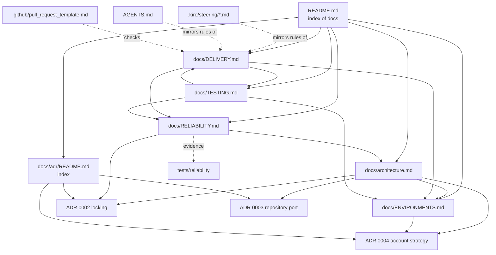
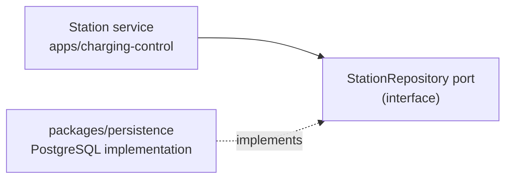

# Design Document

## Overview

This design describes the documentation set, ADRs and agent-guidance files that the later tasks will create. It adds no source code, Terraform or CI changes. Every artifact is Markdown, so "components" below are files and "interfaces" are the links, rule IDs and table schemas that tie them together.

Design principles:

- One source of truth per topic. Other files link to it instead of restating it.
- The workflow rules exist in three places (Delivery_Doc, Steering_Files, Agents_File). Each rule has a stable ID so the copies can be compared mechanically.
- Reliability figures are evidence-only. An empty cell is "not yet measured", never an estimate.
- Anything not verifiable from the repository is labelled an assumption.

### Facts verified in the repository

| Fact | Source | Design consequence |
|---|---|---|
| Section 13 item 9 reads "AWS region, chosen AZ count, AWS account/environment strategy (dev/stage/prod), VPC egress/NAT/VPC endpoints, costs and quotas". The item is under "Can start with documented defaults, then validate". | `docs/architecture.md` section 13 | Item 9 bundles five topics. Only the account/environment part is resolved. The edit must narrow item 9 to the remaining topics, not delete it. The "(dev/stage/prod)" wording is replaced. |
| ADR 0001 lists "AWS region/account strategy" and "Terraform state backend" as open owner decisions. | `docs/adr/0001-phase-0-1-decisions.md` | ADR 0001 is history and stays unedited. The new account ADR records the account decision and states that it settles that part of ADR 0001's open list. Region and state backend stay open. |
| Section 11 already lists `tests/protocol`, `tests/integration`, `tests/reliability`, `tests/load`. | `docs/architecture.md` section 11 | Requirement 2.5 needs no edit. The design only verifies it. |
| `lockStation(q, stationId)` is a free function in `packages/persistence/src/station-repository.ts` that runs `SELECT ... FOR UPDATE` on `station.station`. `StationService.boot()` imports it, plus `insertStation`, `listStations`, `recordBoot` and `withTransaction`, directly from the persistence package. | source files | The port ADR describes the target shape (service depends on an interface). The current code does not have it, which is why the refactor is a separate follow-up. |
| `ci.yml` has jobs `node` (typecheck, lint, test:unit, test:integration against a Postgres service), `terraform` (fmt, init `-backend=false`, validate for dev only) and `images` (docker build for `ocpp-gateway` and `charging-control`, no push). | `.github/workflows/ci.yml` | Delivery_Doc "as is" section lists exactly these. Deploy, smoke, push to a registry, plan/apply and prod are "planned, not implemented". |
| Terraform has local state; the remote backend is an open decision (item 14). `region` is a required variable with no default. | `versions.tf`, `variables.tf` | Environments_Doc marks the state key convention as planned until a backend exists. |
| `package.json` has `typecheck`, `lint`, `test`, `test:unit`, `test:integration`, `db:up`, `db:down`. `tests/` has a tsconfig and `tests/support/charger.ts` (per ADR 0001 D12). | `package.json`, ADR 0001 | Testing_Doc documents the existing scripts and marks `tests/reliability` and `tests/load` as planned where nothing exists yet. |

### Requirement conflict to resolve

Requirement 3.6 and the glossary say "stage and prod as planned". The user's environments example and clarify-phase answer say the environments are **local, dev, prod, with no staging**. This design follows the user's example. The Environments_Doc lists the deviation from the requirements text, as Requirement 3.7 asks for conflicts. During task execution, adjust the Requirement 3.6 wording to "prod planned; no staging environment".

## Architecture

### Document map



Dependency direction: ADRs are leaf records. `architecture.md` links to them. `DELIVERY.md` is the owner of the Workflow_Rules. Steering and AGENTS.md copy condensed forms and link back to `DELIVERY.md`.

### Final file set

| Path | Status | Required by | Note |
|---|---|---|---|
| `README.md` | edit | 1.4 | Add a "Documentation" section listing every file below with one line each. |
| `docs/architecture.md` | edit | 2.x, 8.5 | Narrow edits only, see below. |
| `docs/ENVIRONMENTS.md` | new | 3.x | |
| `docs/DELIVERY.md` | new | 4.x, 6.5 | |
| `docs/RELIABILITY.md` | new | 5.x | |
| `docs/TESTING.md` | new | 9.x | Recommended include. |
| `docs/adr/0002-locking-strategy.md` | new | 7.x | |
| `docs/adr/0003-repository-port.md` | new | 8.x | |
| `docs/adr/0004-single-aws-account-environments.md` | new, recommended | 2.2 | Optional per the user. See ADR plan. |
| `docs/adr/README.md` | new, suggested | improvement | ADR index and numbering rule. |
| `docs/adr/TEMPLATE.md` | new, suggested | improvement | Section skeleton. |
| `.kiro/steering/workflow.md` | new | 6.6 | |
| `.kiro/steering/engineering-rules.md` | new | 7.6, 8.3 | |
| `AGENTS.md` | new | 6.7, 7.6, 8.4 | |
| `.github/pull_request_template.md` | new, suggested | improvement | Enforces 5.7, 6.8 and 11.4 in each PR. |

The PR template is a repository configuration file and not source code, Terraform or a workflow. It still falls outside the requirements' file list, so the owner must approve it (see "Suggested improvements").

## Components and Interfaces

### Cross-file conventions

**Rule IDs.** Each Workflow_Rule and engineering rule carries an ID. The same ID and a matching one-line summary appear in `DELIVERY.md` (full text), `.kiro/steering/*.md` and `AGENTS.md` (condensed).

| ID | Rule | Source requirement |
|---|---|---|
| W1 | Each change starts in a new git worktree on a dedicated branch. | 6.1 |
| W2 | Verify the change by explicit methods or existing tests before opening a pull request. | 6.2 |
| W3 | Open a GitHub pull request after verification. A human reviews every PR before merge, including AI-assisted ones. | 6.3, 4.6 |
| W4 | Every architectural change gets an ADR. | 6.4 |
| W5 | When W1 to W4, L1, L2 or P1 change, update Delivery_Doc, Steering_Files and Agents_File in the same PR. | 6.8 |
| R1 | A change to retry, idempotency, locking, timeout or capacity behaviour updates `RELIABILITY.md` in the same PR. | 5.7 |
| L1 | Use pessimistic locking (`SELECT ... FOR UPDATE`) for short per-station serialization. | 7.4 |
| L2 | Use optimistic row-version locking for low-contention updates. | 7.5 |
| P1 | Application and domain code depend on repository ports, not on database clients. | 8.3 |

**Link style.** All inter-document links are relative Markdown links, for example `[ENVIRONMENTS](ENVIRONMENTS.md)` or `[ADR 0002](adr/0002-locking-strategy.md)`.

**Assumption marker.** A statement that cannot be verified in the repository is written as `**Assumption:** ...` and copied into the PR description (Requirement 11.4).

**Doc header.** Each new doc starts with a title, a one-line purpose, a `Status` line (for example "Describes current state" or "Describes planned state") and a "Related" line of relative links.

### README.md (edit)

Add a "Documentation" section: a table of path and one-line purpose for `architecture.md`, `ENVIRONMENTS.md`, `DELIVERY.md`, `RELIABILITY.md`, `TESTING.md`, `adr/` (via its index) and `AGENTS.md`. Existing README content is kept.

### docs/architecture.md (edit)

Edits are limited to the following. Sections 1 to 12 are not touched.

1. **Section 13 item 9.** Replace "AWS account/environment strategy (dev/stage/prod)" with nothing and keep the rest: "AWS region, chosen AZ count, VPC egress/NAT/VPC endpoints, costs and quotas." Add a sentence after the "Phase 1 resolutions" paragraph: "Account and environment strategy: resolved, see [ADR 0004](adr/0004-single-aws-account-environments.md) and [ENVIRONMENTS](ENVIRONMENTS.md)."
2. **Locking and repository references.** In the same trailing area add: "Locking: [ADR 0002](adr/0002-locking-strategy.md). Repository port: [ADR 0003](adr/0003-repository-port.md)." (Requirement 2.4.)
3. **Dependency direction (Requirement 8.5).** The text must not change sections 1 to 12, so place it in a new short subsection at the end of section 13 or as new section 16, titled "Dependency direction". Content: `apps/charging-control` (application layer) → repository port (interface owned by the domain or application layer) ← `packages/persistence` (implementation). A diagram:



   Add a note: "Target state; the current code imports persistence functions directly. See ADR 0003."
4. **Environments link (Requirement 2.1).** Add to the section-13 paragraph above: "Environments: [ENVIRONMENTS](ENVIRONMENTS.md)."

Decision for the owner: placing the dependency-direction text in a new section 16 keeps Requirement 2.3 strictly true. If the owner prefers section 11 (monorepo layout), Requirement 2.3 must be relaxed.

### docs/ENVIRONMENTS.md

Based on the user's example: local, dev and prod; Docker Compose locally; AWS for dev and prod; no staging; immutable artifact promotion; Terraform modules; separate IAM, secrets and state.

Outline:

1. **Purpose and status.** Describes three environments. Provisioned today: `local` (docker-compose.yml) and `dev` (`infrastructure/terraform/environments/dev`). `prod` is planned and not provisioned. There is no staging environment.
2. **Environment overview table.**

| Environment | Where it runs | Provisioned by | Purpose | Status |
|---|---|---|---|---|
| `local` | Developer machine, Docker Compose | `docker-compose.yml`, `npm run db:up` | Development, unit and integration tests, charger harness | Exists |
| `dev` | AWS, shared account | Terraform `environments/dev` | Integration, cloud smoke tests, load and failure experiments | Exists |
| `prod` | AWS, shared account | Terraform `environments/prod` (not created) | Operated platform for authorized internal drivers | Planned |

3. **Single AWS account.** All AWS environments share one account (see ADR 0004). Isolation is by convention and IAM, not by an account boundary. The doc states the risk and its mitigations plainly: a mistaken credential or policy can reach the other environment, so each environment has its own roles with resource-name-scoped permissions, and CI uses a separate role per environment.
4. **Isolation dimensions.** A table with one row per dimension and columns `local`, `dev`, `prod`:
   - IAM: ECS task roles, execution roles and CI deploy roles are per environment, scoped to resources whose names contain the environment token. No role is shared between `dev` and `prod`. A human or CI role that can apply `dev` cannot apply `prod`.
   - AWS resources: separate VPC, ECS cluster, ALBs, RDS, ElastiCache and SQS queues per environment. No cross-environment security-group rules.
   - Secrets: separate Secrets Manager / SSM paths per environment, separate KMS keys where used. Local uses `.env` files that are not committed.
   - Terraform state: separate state key per environment, and separate lock entries. The backend is not decided (architecture section 13 item 14, ADR 0001), so this is stated as the convention to apply once the backend exists. Today state is local and ignored by git.
5. **Naming convention.** Pattern `csms-<env>-<resource>`, where `<env>` is `local`, `dev` or `prod`.

| Item | Pattern | Example |
|---|---|---|
| AWS resource name | `csms-<env>-<resource>` | `csms-dev-ocpp-gateway` |
| Secret path | `/csms/<env>/<service>/<name>` | `/csms/dev/charging-control/db-password` |
| Terraform state key | `csms/<env>/terraform.tfstate` | `csms/prod/terraform.tfstate` |
| Tags | `Project=csms`, `Environment=<env>`, `ManagedBy=terraform` | matches existing `default_tags` in `versions.tf` |
| Compose project | `csms-local` | |

   Assumption: existing dev resource names may not yet follow this pattern. The task author checks `main.tf` and the modules and lists mismatches under "Known gaps"; renaming is out of scope.
6. **Artifact promotion.** Images are built once from a commit, identified by digest, and the same digest is promoted from `dev` to `prod`. Environment differences come only from configuration: environment variables, secrets and Terraform variables. No rebuild per environment. Status: planned, because `ci.yml` builds images but does not push them.
7. **Terraform structure.** `modules/` (`alb`, `database`, `ecs-service`, `network`) are shared. `environments/<env>` composes the modules with environment variables. Adding `prod` means adding `environments/prod`, not changing modules for prod only.
8. **Configuration differences.** Table of knobs that differ by environment, such as `REQUIRE_FORWARDED_HTTPS` (off locally, on in AWS), instance counts, Multi-AZ, deletion protection, log retention. Values are listed only if present in the repository, otherwise "to be decided".
9. **Deviations from the supplied example and requirements.** List: (a) no staging environment, versus the requirements text that mentions stage; (b) the example's per-environment account or separate-state wording is applied inside one account (ADR 0004); (c) artifact promotion and remote state are planned.
10. **Related.** Links to architecture, DELIVERY, ADR 0004.

### docs/DELIVERY.md

1. **Purpose, status, related.**
2. **Pipeline today.** One table from `ci.yml`: job `node` (typecheck, lint, unit tests, integration tests with Postgres 16), job `terraform` (fmt check, init without backend, validate, dev only), job `images` (docker build for `ocpp-gateway` and `charging-control`, not pushed). Triggers: push to `main` and every pull request.
3. **Planned, not implemented.** Registry push, `terraform plan` on PR, `terraform apply` per environment, deploy to dev, post-deploy smoke tests, prod deploy with approval, image signing and security scans (architecture item 14).
4. **Infrastructure provisioning.** Plan and apply per environment, in Terraform terms: plan in review, apply by an environment-scoped role, dev first. Marked as the target flow because apply is not automated yet.
5. **Quality gates before merge.** Existing gates: typecheck, lint, unit tests, integration tests, terraform fmt and validate, image build. Review gate: one human approval. Documentation gate: R1 and W5 checks from the PR template.
6. **Deployment safety.** Rolling ECS deploys with connection draining (architecture sections 9 and 12 phase 7), migrations compatible with the previous and next application version, rollback by redeploying the previous image digest, forward-only migrations with an expand/contract approach. Items not yet implemented are marked.
7. **AI-assisted development.** Agents may write code, docs and PRs. A human reviews every PR before merge. Agents do not merge, apply Terraform to `prod` or install skills without approval.
8. **Change workflow.** Numbered steps from worktree to merge: create worktree and branch (W1), implement, verify (W2), update docs (R1, W5), open PR (W3), human review, merge. ADR step for architecture changes (W4).
9. **Workflow rules.** Full text of W1 to W5, R1, L1, L2, P1, each with ID, rule and rationale. This section is the source of truth for the condensed copies.
10. **Testing guidance.** One paragraph linking to TESTING.md.

### docs/RELIABILITY.md

1. **Purpose, status, related.** States up front that the file holds evidence, not targets.
2. **Targets (not results).** A short table repeating 10,000 stations, 5,000 sessions and 99.9% with the column "Status: target, not yet measured". Requirement 5.6 is met by the explicit status column and by never using these numbers elsewhere.
3. **Failure scenarios.** One table. Columns: `Scenario | Expected behaviour | ADR | Architecture section | Evidence`.

| Scenario | ADR | Architecture section |
|---|---|---|
| Concurrent boots for one station from two gateway replicas | [0002](adr/0002-locking-strategy.md) | 3.1, 7 |
| Duplicate or reordered SQS delivery | 0001 (A-series) | 5, 7 |
| Lost HTTP response after commit (sync call) | 0001 | 5 |
| Control service unavailable at handshake or boot | 0001 D1 (fails closed) | 5 |
| Redis outage with commands pending | none yet, mark "no ADR yet" | 7 |
| DB failover during request | none yet | 9 |

   Every row has a non-empty ADR and architecture link, or the literal text "none yet" in the ADR cell. Requirement 5.5 says "link each failure scenario to the relevant ADR", so a scenario without an ADR is a signal to write one or to state that none applies.
4. **Retries and idempotency.** Per path: mechanism, link, evidence status.
5. **Measured results.** Table with columns `Topic | Metric | Value | Date | Environment | Method | Evidence link`. Only rows with all of value, date, environment and method are allowed. Initially the table is empty and each topic (latency, throughput, recovery time, operational limits) reads "not yet measured".
6. **Operational limits.** Same rule: measured or "not yet measured".
7. **Evidence link.** Each measured row links to the test that produced it under `tests/reliability` or `tests/load` and to the run output location. Directories do not exist yet, so the doc states "evidence directories are planned".
8. **Maintenance rule.** R1.

### docs/TESTING.md (include/omit evaluation)

Recommendation: **include**.

| Content | Belongs in DELIVERY.md? | Belongs in TESTING.md? |
|---|---|---|
| Which gates run in CI and when a change merges | yes | link only |
| What each test directory contains and how to run it | no, not a delivery concern | yes |
| Local tests (unit, integration with Compose Postgres) versus tests against dev (smoke, reliability, load) | partly | yes |
| Charger harness (`tests/support/charger.ts`), OCPP schema validation, protocol contract tests | no | yes |
| Evidence handling for reliability and load runs | no | yes, linking to RELIABILITY.md |

Reason: the four `tests/` directories and the local-versus-cloud split are about how tests are built and run, which changes more often and for different reasons than the pipeline. Putting this into DELIVERY.md would grow it with content that has a different audience. DELIVERY.md keeps one paragraph and a link, so no content is duplicated (Requirement 9.2 evaluated, outcome include).

Outline:

1. Purpose, status, related.
2. **Test layers.**

| Directory | Purpose | Runs where | Status |
|---|---|---|---|
| unit tests next to source (`*.test.ts`) | Pure logic | local, CI `node` | exists |
| `tests/protocol` | OCPP 1.6J and 2.0.1 message and schema contract tests using the charger harness | local, CI | planned unless files exist at execution time |
| `tests/integration` | Services with real PostgreSQL (Compose locally, service container in CI) | local, CI | exists via `test:integration` (assumption: verify directory contents) |
| `tests/reliability` | Failure injection, duplicate and out-of-order delivery, recovery. Writes evidence for RELIABILITY.md | local for logic, dev for infrastructure faults | planned |
| `tests/load` | Connection and session load profiles toward the 10,000 and 5,000 targets | dev only | planned |

3. **Local versus cloud.** Local: Compose, `npm run db:up`, `npm test`. Cloud: smoke tests after a dev deployment, reliability and load tests against `dev`. Cloud tests never target `prod` without explicit approval. Cloud smoke tests are planned (DELIVERY.md).
4. **Commands.** Real scripts from `package.json`.
5. **Property-based testing guidance.** Where it fits (pure logic: OCPP adapters, idempotency keys, sequence ordering) and where it does not (Terraform, wiring).
6. **Linking tests to RELIABILITY.md.** Each reliability test names the RELIABILITY.md scenario row it supports, and each measured row links back to its test.

### ADR plan

Common format for new ADRs (`docs/adr/TEMPLATE.md`): `# ADR NNNN: Title`, `Status` (Proposed, Accepted, Superseded by NNNN), `Date`, `Deciders`, then `Context`, `Decision`, `Alternatives considered`, `Consequences`, `Related`. Numbers are sequential four-digit and never reused.

**ADR 0002: Keep pessimistic row locking in `lockStation()`** (Requirement 7)

- Context: concurrent BootNotification calls for the same station can arrive at different gateway replicas, and the boot decision plus `recordBoot` must be serialized per station for a short time. `lockStation()` runs `SELECT station_id, registration_status FROM station.station WHERE station_id = $1 FOR UPDATE` inside `withTransaction`.
- Decision: keep it. Locking rule: L1 pessimistic for short per-station serialization, L2 optimistic row-version for low-contention updates.
- Alternatives: optimistic version column with retry (extra retries and a failing path for a hot, short operation); advisory locks (`pg_advisory_xact_lock`, no row needed, but lock keys live outside the schema and are harder to reason about); Redis lock (adds a dependency that the architecture says is not a source of truth); no lock plus unique constraints (cannot serialize the read-decide-write sequence).
- Consequences: lock held only for the transaction, so transaction scope must stay short and must not include network calls; blocked boots wait instead of failing; if the station row does not exist, nothing is locked (current code returns `null` and persists nothing); lock waits need a statement or lock timeout, which is noted as follow-up and not changed here. The `lockStation()` implementation is not modified (7.7).
- Reliability link: first RELIABILITY.md scenario row.

**ADR 0003: Introduce a repository port between persistence and the station service** (Requirement 8)

- Context: `StationService` imports persistence functions and takes a `pg` pool. Domain logic is coupled to the database client.
- Decision: define a `StationRepository` interface owned by the domain or application layer, with the service depending on it and `packages/persistence` implementing it. Rule P1.
- Illustrative shape (not implemented in this feature):

```typescript
export interface StationRepository {
  withTransaction<T>(work: (tx: StationTx) => Promise<T>): Promise<T>;
}

export interface StationTx {
  lockStation(stationId: string): Promise<StationLockRow | null>;
  recordBoot(input: RecordBootInput): Promise<void>;
  insertStation(input: NewStation): Promise<void>;
  listStations(): Promise<StationSummary[]>;
}
```

  The transaction scope stays on the port so the lock in ADR 0002 keeps its transaction boundary.
- Alternatives: keep direct imports (simple, couples domain to `pg`); an ORM repository (conflicts with the open ORM decision, item 10); a port only for new modules (inconsistent).
- Consequences: unit tests can use an in-memory fake; one extra interface to maintain; the refactor is a separate follow-up task (8.6), so until then the code does not match the ADR, and the ADR's status line says "Accepted; implementation pending".
- Open question for the follow-up: where the interface lives (`packages/domain/stations` is the existing candidate).

**ADR 0004: Single AWS account with per-environment isolation** (recommended, optional)

- Recommendation: write it. Requirement 2.2 changes the architecture baseline, and W4 requires an ADR for architectural changes. Writing it also lets `ENVIRONMENTS.md` and `architecture.md` link to one rationale.
- Context: environments local, dev, prod, no staging. Cost and operating overhead of multiple accounts for a small private platform.
- Decision: one AWS account; isolation by IAM roles, resource naming, secrets paths and Terraform state keys.
- Alternatives: account per environment (stronger blast-radius isolation and SCPs, more overhead); a separate prod account only (a middle path, deferred); a staging environment (rejected by owner).
- Consequences: weaker isolation than separate accounts; no account-level service control policies; account-level quotas are shared by dev load tests and prod, so load tests on dev can consume quota that prod needs (state this in RELIABILITY.md as an operational limit to measure); revisit trigger: first real prod users or a compliance need.
- Related: the part of the ADR 0001 open list that this settles.

### Steering and AGENTS.md outlines

Both are short and link to `docs/DELIVERY.md` for the full text. Steering files use `inclusion: always`. Verify the front-matter syntax against existing `.kiro/steering` conventions when creating them. No steering directory exists today.

**`.kiro/steering/workflow.md`**

1. Front matter (always included).
2. Change workflow: W1 to W5 as five one-line bullets.
3. Reliability doc rule R1.
4. Reminder to list assumptions in the PR description.
5. Link to `docs/DELIVERY.md`.

**`.kiro/steering/engineering-rules.md`**

1. Locking: L1, L2, with the pointer to ADR 0002 and the statement "do not change `lockStation()` without a new ADR".
2. Repository ports: P1, with the pointer to ADR 0003 and the note that the current station service does not yet follow it.
3. Environments: never put `prod` resources, secrets or state under a `dev` name or role. Name pattern `csms-<env>-...`.
4. Docs to read first: `docs/architecture.md`, `docs/ENVIRONMENTS.md`.

**`AGENTS.md`**

1. Project in two sentences and the monorepo layout, with a link to `docs/architecture.md`.
2. Commands: `npm run typecheck`, `npm run lint`, `npm run test:unit`, `npm run test:integration`, `npm run db:up`.
3. Workflow rules W1 to W5, R1 (condensed).
4. Engineering rules L1, L2, P1 (condensed).
5. Boundaries: no source, Terraform or CI changes outside the task; do not install skills; no `prod` actions; ask before architectural changes.
6. Doc index with links.

AGENTS.md and steering overlap by design (Requirement 6). Keep each rule to one line and the same wording so the consistency check (Property 3) can match by rule ID.

### Skill recommendations

Executed during tasks, not now, and without installing anything (10.4). Queries: `git worktree`, `architecture decision records` or `adr`, `terraform aws`, `github pull request workflow`, `testing` (plus `property-based testing` as a refinement). Output goes in the final report as a table `Topic | Skill | Source | Reason`, or "no skill found for this topic". Results need network access and may change over time, so they are not stored in the repository docs.

### Suggested improvements to the proposed structure

Each item is optional and needs owner approval because it extends the requirement list.

| # | Suggestion | Reason | Cost |
|---|---|---|---|
| 1 | `.github/pull_request_template.md` with a checklist: verification method (W2), ADR link (W4), RELIABILITY.md updated or "not applicable" (R1), mirrors updated (W5), assumptions list (11.4), human review | The rules are only effective if each PR is asked the questions. | One file |
| 2 | `docs/adr/README.md` index and `docs/adr/TEMPLATE.md` | Prevents numbering clashes and gives all ADRs the same sections. ADR 0001 has a different shape, so the index notes that. | Two files |
| 3 | Keep the doc index in the root `README.md` only, not a separate `docs/README.md` | Avoids two indexes drifting apart. GitHub renders `docs/README.md` automatically, so a one-line `docs/README.md` that links up could be added if wanted. | None |
| 4 | Two-way link between RELIABILITY.md and `tests/reliability` and `tests/load` (see Reliability and Testing outlines) | Keeps figures traceable to the run that produced them. | Convention only |
| 5 | A small doc-lint script (link check, rule-ID consistency, reliability table check) run in CI | Makes Properties 1 to 5 enforceable. This is code and CI, so it is a follow-up outside this feature. | Follow-up task |
| 6 | `CODEOWNERS` entries for `docs/adr/` and `docs/RELIABILITY.md` | Routes the human review the workflow requires. | One file, needs team names |
| 7 | Add a "Last verified" date to ENVIRONMENTS.md and DELIVERY.md status lines | These two describe state that drifts from the code. | Convention only |

## Data Models

There is no runtime data. These are the structured tables that other checks rely on.

**Rule registry** (in DELIVERY.md): `id`, `summary`, `source requirement`. IDs match `^(W|R|L|P)\d+$`.

**Reliability scenario row**: `scenario`, `expected behaviour`, `adr` (link or "none yet"), `architecture section` (link), `evidence` (link or "not yet measured").

**Measured result row**: `topic`, `metric`, `value`, `date` (ISO 8601), `environment` (one of `local`, `dev`, `prod`), `method`, `evidence link`. All seven cells are non-empty, or the topic appears in the "not yet measured" list instead.

**ADR header**: `number` (four digits), `title`, `status`, `date`.

**Environment names**: the closed set `local`, `dev`, `prod`.

## Error Handling

Documentation failure modes and their handling:

| Failure | Handling |
|---|---|
| A statement cannot be verified against the repository | Mark as `**Assumption:**` and list it in the PR description (11.4). |
| Broken or absolute inter-document link | Fix before the PR is opened; Property 1 describes the check. |
| Current files drift from the docs (CI jobs, directories, scripts) | Task authors re-read `ci.yml`, `package.json` and the tree at execution time, not trusting this design's snapshot. |
| The three rule copies disagree | The `DELIVERY.md` text wins. Fix steering and AGENTS.md in the same PR (W5). |
| Architecture sections 1 to 12 accidentally edited | Revert; Property 6 describes the diff check. |
| Source, Terraform or CI file appears in the diff | Remove from this feature's PR (Property 7). The port refactor is recorded as a follow-up task and nothing else. |
| ADR number already taken at execution time | Take the next free number and update links. |
| Reliability figure without date, environment or method | Remove the figure or replace with "not yet measured". |
| Skill search returns nothing or the tool is unavailable | Report "no skill found" or the failure for that topic (10.3). |
| Existing resource names do not match the naming convention | List under "Known gaps" in ENVIRONMENTS.md; do not rename. |

## Testing Strategy

Property-based testing is only partly applicable. The deliverables are Markdown, so most criteria are verified by example checks and review. A few criteria are universal checks over many links, rules or table rows. They are expressed as properties below and can be checked by a script. Per the classification, the script is a follow-up (suggestion 5) and is not created by this feature. Until it exists, the task author performs the checks manually with `grep` and `git diff`, and states the result in the PR.

**Example checks (manual or grep):**

- Files from the final file set exist and `docs/` contains only flat files plus `adr/` (1.1, 1.2, 1.5).
- `architecture.md` links to ENVIRONMENTS.md, ADR 0002 and ADR 0003 (2.1, 2.4) and lists `tests/protocol`, `tests/integration`, `tests/reliability`, `tests/load` (2.5).
- Section 13 item 9 no longer mentions account strategy but still lists the other four topics (2.2).
- ENVIRONMENTS.md states single account, per-environment IAM, resources, secrets and state, marks `prod` planned and `dev` the only provisioned Terraform environment (3.2 to 3.6), and lists deviations (3.7).
- DELIVERY.md names jobs `node`, `terraform`, `images` and marks deploy, smoke and prod as planned (4.1, 4.2).
- Locking ADR has Context, Decision, Alternatives, Consequences and the boot-serialization use case (7.2, 7.3).
- Testing include decision and reason appear in the final report (9.5).
- Skill report covers all five topics with name, source and reason, or "no skill found" (10.x). This depends on an external search tool and is verified manually.

**Property checks** (if scripted: any property-test library, such as fast-check, with at least 100 iterations when generating inputs; for repository-state checks one run over the real files is enough). Tag format: **Feature: project-docs-structure, Property N: ...**

## Correctness Properties

*A property is a characteristic or behavior that should hold true across all valid executions of a system-essentially, a formal statement about what the system should do. Properties serve as the bridge between human-readable specifications and machine-verifiable correctness guarantees.*

After reflection, criteria 2.1 and 2.4 (specific links) are covered by Property 1. Criteria 6.5 to 6.7, 7.6, 8.3 and 8.4 collapse into Property 3. Criteria 7.7, 8.6, 11.1 and 11.2 collapse into Property 7.

### Property 1: Inter-document links are relative and resolve

For any markdown link in any file of the Docs_Set, Steering_Files or Agents_File that points to another repository file, the link target is a relative path and the target file exists. Related-file links required by the design (for example ENVIRONMENTS, ADR 0002 and ADR 0003 from `architecture.md`) are present.

**Validates: Requirements 1.3, 2.1, 2.4, 5.5**

### Property 2: README indexes every Docs_Set file

For any file in `docs/*.md` and `docs/adr/*.md` (excluding templates), the root `README.md` contains a link to that file, or to the ADR index that links it, together with a non-empty one-line purpose.

**Validates: Requirements 1.4**

### Property 3: Rule IDs are mirrored across the three rule locations

For any rule ID in the rule registry (W1 to W5, R1, L1, L2, P1), that ID appears in `docs/DELIVERY.md`, and also in at least one file of `.kiro/steering/` and in `AGENTS.md`, with the same one-line summary.

**Validates: Requirements 6.5, 6.6, 6.7, 7.6, 8.3, 8.4**

### Property 4: Reliability figures carry evidence

For any row in the measured-results table of `docs/RELIABILITY.md`, the value, date, environment, method and evidence-link cells are all non-empty and the environment is one of `local`, `dev`, `prod`. For any topic without such a row, the document marks the topic "not yet measured".

**Validates: Requirements 5.2, 5.3, 5.4**

### Property 5: Every failure scenario links to an ADR and an architecture section

For any row in the failure-scenario table of `docs/RELIABILITY.md`, the architecture-section cell is a resolving link to `architecture.md` and the ADR cell is either a resolving ADR link or the literal "none yet".

**Validates: Requirements 5.5**

### Property 6: Architecture sections 1 to 12 are unchanged

For any line in sections 1 to 12 of `docs/architecture.md` at the base commit, the same line exists in the same order after the change.

**Validates: Requirements 2.3**

### Property 7: Documentation PRs touch only allowed paths

For any changed file in the pull request that delivers this feature, the path is in the allow-list: `docs/`, `README.md`, `AGENTS.md`, `.kiro/steering/`, `.github/pull_request_template.md` (if approved), and `.kiro/specs/project-docs-structure/`. In particular `packages/persistence/src/station-repository.ts` and `apps/` are never changed.

**Validates: Requirements 7.7, 8.6, 11.1, 11.2**

### Property 8: Environment naming convention is applied

For any resource name, secret path or state key written as an example in `docs/ENVIRONMENTS.md`, the string contains exactly one environment token from `local`, `dev`, `prod`, in the position defined by the naming table.

**Validates: Requirements 3.4**

### Property 9: Delivery doc covers every CI job

For any job id defined in `.github/workflows/ci.yml`, `docs/DELIVERY.md` names that job. For any pipeline capability named in the doc as existing, a corresponding job or step exists in `ci.yml`.

**Validates: Requirements 4.1, 4.2**

## Open points for the owner

1. Approve ADR 0004 (recommended) and the PR template, ADR index and ADR template (suggestions 1 and 2).
2. Confirm "no staging" and allow rewording of Requirement 3.6.
3. Choose where the dependency-direction description goes in `architecture.md`: new section 16 (keeps 2.3 true, recommended) or section 11.
4. Confirm the repository state of `tests/integration` and `tests/protocol` at execution time. Those rows in TESTING.md are written from what exists then.
