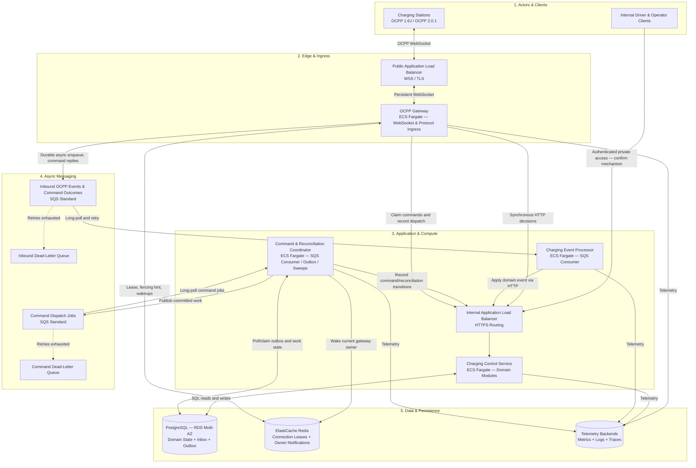
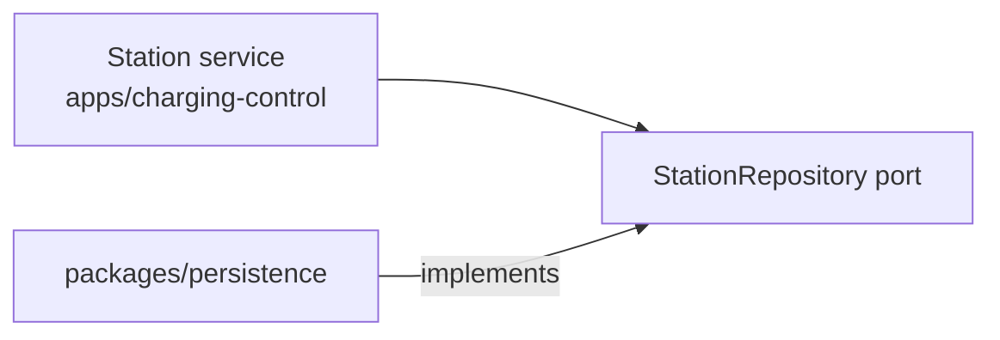

# Private AWS CSMS — Architecture v1.0

**Status:** Agreed architecture baseline; not yet an implementation-ready specification.  
**Date:** 2026-11-18  
**System:** Private-network Charge Point Operator (CPO) Charging Station Management System (CSMS).  
**Languages / platform:** TypeScript, Node.js, AWS, Terraform.  
**Supported protocols:** OCPP 1.6J and OCPP 2.0.1 (JSON over WebSocket), selected operations only.

## 1. Goals and scope

Build a realistic, resilient, observable, privately operated charging platform for authorized internal drivers. Optimize for demonstrable software engineering judgment, clear module boundaries, durable workflows, explicit failure modes, and reasonable operational complexity.

**In scope:** Charger connectivity; boot, heartbeat, status and metering; authorization; station/EVSE/connector inventory; credential management and offline RFID allowlists; charging sessions; charger-enforced reservations; remote commands; command tracking; transaction reconciliation; domain incidents; telemetry; load and failure testing.

**Out of scope:** OCPI, roaming/MSPs, payments, billing, settlement, advanced smart charging/load balancing, full OCPP coverage, cross-region disaster recovery. Charger simulation is a development/testing concern **outside the deployed production architecture**.

**Scale and resilience targets:** 10,000 concurrently connected stations; 5,000 concurrent charging sessions; 99.9% availability objective; one AWS region, multiple availability zones; no cross-region DR. These are targets requiring load testing, not claims already validated.

## 2. Architectural decisions

| Topic | Final direction | Rationale / caution |
|---|---|---|
| Architecture | Modular monolith for domain logic; four independently deployable application components | Avoid fine-grained service coupling while scaling distinct workloads |
| Repo | TypeScript monorepo with shared packages | Consistent contracts, tooling and workflows |
| Containers | Four Node.js containerized ECS Fargate services | Stateful sockets and continuous worker polling; no initial Lambda requirement |
| Gateway | OCPP Gateway in **logical Edge & Ingress** layer, behind public ALB | Dedicated protocol boundary; gateway is still an ECS container |
| Internal HTTP | Internal ALB -> Charging Control Service | Synchronous gateway decisions; worker-domain communication |
| Async ingestion | SQS **Standard** queues | At-least-once and possible out-of-order delivery intentionally handled |
| Persistence | One PostgreSQL database, RDS Multi-AZ; logical schemas or modules | Transactional consistency without distributed DB coordination |
| Routing | ElastiCache Redis for time-bounded connection leases and best-effort owner notifications | Not a durable command queue or domain source of truth |
| Outbox | PostgreSQL transactional outbox, polled by coordinator | No dual-write gap between domain state and published work |
| IaC | Terraform | One source-controlled configuration for AWS resources |
| Monitoring | OpenTelemetry, structured logs, metrics, traces, CloudWatch; optional Grafana | Domain incidents persist in PostgreSQL, not only monitoring tools |
| API security | Authenticated private internal access; station authentication on WSS | Concrete identity and exposure policy is a pre-implementation decision |

## 3. Deployment units and ownership

### 3.1 OCPP Gateway — ECS Fargate

Owns long-lived WebSocket connections; charger authentication/handshake; OCPP subprotocol negotiation; frame/schema validation; OCPP CALL / CALLRESULT / CALLERROR correlation; serialization and protocol-version adapters; synchronous calls to domain HTTP APIs; SQS enqueue-before-ack for async calls; in-process socket registry; Redis owner leases; owner-directed outbound commands; graceful drain/reconnect. **Does not** own driver authorization rules, reservation rules, or session business state.

### 3.2 Charging Control Service — ECS Fargate

One independently deployed domain API/application with **internal modules**, not separate microservices:

| Module | Owns |
|---|---|
| Station Management | Charging stations, EVSEs, connectors, capabilities, settings, domain connectivity state |
| Access & Authorization | Internal drivers, RFID credentials, access policy, revocation, desired charger-local allowlists |
| Sessions | Starts/ends, transaction sequence and dedup rules, meter readings, energy, reconciliation state |
| Reservations | Requested EVSE/connector, expiry, logical conflict control, charger confirmation |
| Remote Operations | Commands, attempts, expiry, acknowledgments, observed completion, indeterminate outcomes |
| Operational Incidents | Charger faults, stale sessions, unavailable EVSEs, incident lifecycle and resolution |

The service owns domain writes and domain idempotency rules. It contains HTTP endpoints for the gateway and workers plus authenticated internal driver/operator API endpoints. It persists domain events and required outbox records in the same PostgreSQL transaction.

### 3.3 Charging Event Processor — ECS Fargate

A long-polling **SQS consumer**, independently scalable. Consumes charger-originated async operations, connection lifecycle notifications where needed, and outbound-command response/outcome envelopes. Validates event envelopes and calls the appropriate **Charging Control Service internal endpoint** over the internal ALB. Deletes an SQS message only after domain processing has committed or a known idempotent result was returned. Uses retry/backoff, visibility-timeout management, and DLQ handling. It is not a second owner of business rules.

### 3.4 Command & Reconciliation Coordinator — ECS Fargate

One deployment with isolated internal loops: (a) claim and publish committed outbox rows to SQS; (b) long-poll command jobs and route wakeups toward the current gateway owner; (c) sweep overdue commands, unsynchronized reservations, credentials, stale sessions, missing OCPP 2.0.1 transaction sequences, and failed workflows. Uses database claims/locks to prevent concurrent sweep collisions. Invokes Charging Control's APIs for domain transitions. Redis notifications are **hints**; database polling/reconciliation is the recovery path.

**No Lambda functions are required for v1.** A scheduled ECS task or EventBridge Scheduler can be introduced later if periodic work should be decoupled from the coordinator's long-running process.

## 4. Architecture diagram — five sequential layers

The gateway is intentionally placed in Edge & Ingress **by logical responsibility**, though it is deployed as an ECS Fargate container. The internal ALB belongs to the application-serving layer; a private/internal ALB does not represent a return trip through the public edge.



**Diagram semantics:** The PostgreSQL arrows represent initiated SQL queries and returned results; **PostgreSQL does not actively push domain events**. The coordinator queries outbox rows, publishes committed work, and marks publication progress. The Gateway -> internal ALB calls never traverse the public ALB. Gateway has a physical AWS runtime in ECS despite its logical ingress placement.

## 5. Processing contracts: OCPP calls

Every valid OCPP CALL requires an appropriate protocol-level response; *synchronous* and *asynchronous* refer to **business processing before acknowledgment**, not whether a protocol response exists.

| Charging-station-initiated operation | Version | Processing mode | Response boundary |
|---|---|---|---|
| BootNotification | 1.6J / 2.0.1 | Sync: Gateway -> domain HTTP | Domain's boot/registration decision |
| Authorize | 1.6J / 2.0.1 | Sync: Gateway -> domain HTTP | Authorization result |
| StartTransaction | 1.6J | Sync: Gateway -> domain HTTP | Transaction ID and authorization result persisted |
| TransactionEvent (Started) | 2.0.1 | **Always sync**, agreed | Transaction start decision/state persisted |
| TransactionEvent (Updated) | 2.0.1 | Async by default; **sync if an immediate `idTokenInfo` authorization decision is required** | SQS acceptance, or domain result for sync exception |
| TransactionEvent (Ended) | 2.0.1 | Async by default; classify token-response edge cases by spec | SQS acceptance unless immediate response data needed |
| StopTransaction | 1.6J | Async | SQS acceptance |
| MeterValues | 1.6J; 2.0.1 if supported | Async | SQS acceptance |
| StatusNotification | 1.6J / 2.0.1 | Async | SQS acceptance |
| NotifyEvent | 2.0.1 | Async | SQS acceptance |
| Heartbeat | 1.6J / 2.0.1 | Gateway-local | Gateway protocol response |

**OCPP version nuance:** OCPP 2.0.1 carries core transaction lifecycle and much transaction-metering information through `TransactionEvent`. Do not model it as identical to 1.6 `StartTransaction` + `MeterValues` + `StopTransaction`. If handling standalone 2.0.1 `MeterValues`, implement it only when required by the selected supported-operation subset and validate against that version's schema.

### Synchronous failure contract

Gateway validates/normalizes, calls Charging Control through an **internal** ALB with bounded timeout, receives decision, and responds to the charger. A business denial is a normal OCPP CALLRESULT with an appropriate negative status when defined. Dependency failure, unavailable service, or timeout returns a suitable OCPP CALLERROR, as agreed, with version-correct error mapping. Client retries must be idempotent; commit-then-response-loss must not create a duplicate transaction. Persist deterministic responses / semantic identifiers as appropriate.

### Asynchronous failure contract

Gateway validates, sends a message envelope to SQS Standard and returns a successful OCPP response **only after SQS acceptance**. On enqueue failure, do not return a success acknowledgment. After acceptance, an ECS SQS consumer may receive duplicates or reordered messages; domain application must be idempotent and resilient. Consumer HTTP failure -> retry; known poison messages -> DLQ and alert; DLQ redrive requires an explicit safe procedure. Receipt into SQS is not equivalent to domain persistence.

### Gateway-local heartbeat contract

Return protocol time without waiting for domain HTTP. Keep operational connectivity state via gateway connection lifecycle events, bounded/throttled last-seen updates, and lease-based reconciliation; do not make the availability dashboard depend solely on gateway memory or monitoring metrics.

## 6. Version-independent domain model

- `ChargingStation`: server-side station identity, protocol/version, online and observed capability state.
- `EVSE`: unit that can supply energy to a vehicle; canonical domain object even for 1.6.
- `Connector`: physical socket/cable; mapped from 1.6 connector ID or 2.0.1 EVSE + connector IDs.
- `Driver`, `RFIDCredential`, `AccessPolicy`: only internal authorized identities; explicit credential states/revocation.
- `ChargingSession`: internal UUID, station/EVSE/connector linkage, charger-side external transaction ID, state, energy, evidence/completeness flags.
- `SessionEvent`: immutable incoming observations, protocol metadata, payload reference/hash, transaction ordering data.
- `Reservation`: requested resource, driver/credential, expiry, desired state, physical enforcement state.
- `RemoteCommand`, `CommandAttempt`: desired operation, TTL, target, state, connection epoch, delivery acknowledgment, observed outcome.
- `OperationalIncident`: station/session/command issue, severity, detection/acknowledgment/resolution timestamps.
- `InboxRecord`, `OutboxRecord`: idempotent consumption and transactional publication.

**Transaction IDs:** OCPP 1.6's transaction ID is generated by CSMS (integer); OCPP 2.0.1's external transaction ID is generated by the station (string). An internal session UUID must be separate from both.

**Database design:** one PostgreSQL RDS Multi-AZ database with logically grouped `station`, `access`, `session`, `operation`, and `messaging` schemas (exact names to finalize). Cross-module writes within one Charging Control request can share a DB transaction. The two worker processes communicate via domain APIs for domain state transitions; the coordinator may access the outbox and claim tables through a narrowly scoped persistence adapter.

## 7. Reliable processing patterns

### Inbound deduplication and session ordering

SQS Standard is at-least-once and may reorder. For each event, define an idempotency key with station identity, protocol version, message identity and domain identity. Enforce unique keys in PostgreSQL. One DB transaction handles inbox insertion, domain update, and outbox insert. Same key + same payload -> return prior outcome. Same key + conflicting payload -> quarantine/incident, not silent overwrite.

For 2.0.1 `TransactionEvent`, treat **(station, station transaction ID, `seqNo`)** as a central uniqueness/ordering constraint. Persist observed events, buffer sequence gaps, and apply ordered state transitions under a transaction-level lock. `Ended` should not be finalized as complete while an earlier required event is missing unless an explicit documented reconciliation policy is satisfied.

OCPP 1.6 has no equivalent `seqNo` for all transaction messages: use transaction IDs, charger timestamps, payload fingerprints, unique message IDs, business invariants and explicit uncertainty flags; don't claim perfect deduplication across reissued calls with new IDs.

### Transactional outbox

When Charging Control commits domain state needing asynchronous action, insert an `outbox_event` in the same PostgreSQL transaction. The coordinator claims unpublished rows in bounded batches (`FOR UPDATE SKIP LOCKED` or equivalent), publishes to SQS, and updates publication state. Duplicate publication is possible after ambiguous publish responses; downstream idempotency is mandatory. Outbox is not a distributed transaction with SQS.

### Distributed WebSocket ownership

Gateway instance holds actual sockets in memory. Redis records `{stationId, gatewayInstanceId, connectionId, epoch, leaseUntil}` and supports atomic lease registration/renewal. On reconnect, a new ownership epoch supersedes the old one; old owners must be fenced from claiming or sending new work. Validate the epoch against durable command claims (and, where necessary, a PostgreSQL monotonically increasing station epoch). Redis Pub/Sub is notification-only: it can drop signals, so coordinator retries and gateway re-queries outstanding work after reconnect. During Redis outage, prefer pausing new cross-instance command dispatch over relying on stale ownership; existing protocol exchanges can continue when safe.

### Outbound commands

1. Charging Control validates and persists command (`Queued`, TTL, target, request idempotency key) plus an outbox row.
2. Coordinator publishes/consumes a command job, checks TTL and station status, then notifies current gateway owner via Redis. If offline, keep durable desired state and retry only while valid.
3. Gateway, after receiving a wakeup, calls Charging Control via internal ALB to atomically **claim** a command for its current connection epoch and attempt ID.
4. Gateway writes an OCPP CALL to that owned socket; claim/send transitions are recorded. The gateway correlates subsequent CALLRESULT/CALLERROR or timeout with the attempt.
5. Gateway durably enqueues command response/outcome into SQS, which Charging Event Processor delivers to Charging Control. Some response-loss/crash windows cannot be eliminated: unknown outcomes become `Indeterminate`, then reconciled from charger observations.
6. Domain transitions distinguish `Queued`, `Dispatched`, `Acknowledged`, `Completed`, `Rejected`, `Failed`, `Expired`, and `Indeterminate`. They are **not all a single linear progression**.

**Crucial caveat:** Charger acceptance of remote start is not proof that charging began. Match with subsequent transaction events. Do not blindly resend non-idempotent commands (remote start, reset) when a charger might already have executed them. Use command-specific TTL and safe-retry policies. Outbound command tracking should also be exposed to operators as an audit trail.

### Reservations and offline behavior

Reserve a specific connector/EVSE, not an arbitrary station. Validate conflicts with a DB constraint/transaction, create desired reservation with configurable expiry, persist command/outbox, dispatch OCPP `ReserveNow` to online station. If offline, keep `Pending` and attempt dispatch on reconnection before expiry. Mark `Confirmed` **only after charger acceptance**; otherwise retain `Pending`/`Unknown`/`Rejected` and expose the distinction. Cancel/expire stale work. Offline reservations cannot guarantee physical availability until accepted by the charger. OCPP `ReserveNow` is not a rich future-slot scheduling protocol; sophisticated slot planning remains out of scope.

### Offline RFID authorization

Authorized RFID credentials may be provisioned to supported chargers' local authorization lists, allowing offline initiation. Central revocation while a charger is disconnected **cannot be immediately enforced**. Persist desired list version and per-station synchronization status; retry updates upon reconnection; track `Pending`/`Applied`/`Failed` or equivalent; expose risk/incident if stale. Charger-specific feature support must be detected/tested; avoid assuming every charger supports local lists. Do not log raw RFID credentials.

### Session reconciliation

Periodically detect stale active sessions, started-but-never-ended transactions, sequence gaps, anomalous meter progression, missing command-result observations, and offline sessions replayed after reconnect. Retain raw evidence. Mark results as `Complete`, `Incomplete`, or `Inferred` as appropriate; never fabricate a successful end event. Reconciliation actions must be logged and idempotent.

## 8. HTTP API contracts and event envelopes

**Suggested internal endpoints (illustrative, not locked):**

| Caller | Charging Control endpoint | Purpose |
|---|---|---|
| Gateway | `POST /internal/ocpp/boot` | Boot decision and station registration |
| Gateway | `POST /internal/ocpp/authorize` | Credential check |
| Gateway | `POST /internal/sessions/start` | 1.6/2.0.1 normalized session start |
| Event Processor | `POST /internal/ocpp/events` | Idempotent domain event application |
| Gateway | `POST /internal/commands/{id}/claim` | Epoch-guarded command claim |
| Coordinator | `POST /internal/operations/reconcile` | Domain-owned reconciliation transitions |
| Internal clients | `/api/v1/stations`, `/api/v1/sessions`, `/api/v1/reservations`, `/api/v1/commands`, etc. | Authenticated product API |

Use typed contracts, strict validation, versioned schema evolution, correlation IDs and authentication/authorization for internal routes. Gateway and domain API adapters translate version-specific OCPP payloads into canonical DTOs. Avoid letting raw protocol payloads become the domain model.

**Proposed SQS envelope:** `eventId`, `eventType`, `schemaVersion`, `occurredAt`, `receivedAt`, `stationId`, `ocppVersion`, `ocppMessageId`, `transactionId?`, `sequenceNumber?`, `correlationId`, `connectionEpoch?`, `payload` or payload reference. Explicitly define the stable idempotency key separately from `eventId`.

## 9. AWS infrastructure

| Layer / resource | Direction |
|---|---|
| VPC | At least 2 AZs; public ALB, private ECS tasks, RDS/Redis subnets; restrictive security groups |
| External edge | Internet-facing ALB for station WSS; version-appropriate OCPP subprotocols |
| Gateway | ECS service on Fargate behind public ALB, health/readiness and controlled draining |
| Private application | Internal ALB -> Charging Control ECS service; private access mechanism for client UIs to confirm |
| Workers | Event Processor ECS service polling inbound SQS; Coordinator ECS service polling work SQS |
| SQS | Separate inbound and command-work Standard queues, each with a DLQ and alarms |
| Persistence | RDS PostgreSQL Multi-AZ; migrations, backup/PITR policy, parameter management |
| Redis | ElastiCache Redis, deployed with resilient topology appropriate for 99.9% target; lease TTL and connection epochs |
| Secrets | Secrets Manager / SSM Parameter Store; IAM task roles, KMS where appropriate |
| Observability | OTEL SDK/collector or compatible exporters, CloudWatch metrics/logs/traces and optional Grafana dashboards |
| CI/CD / IaC | Terraform for all repeatable infra; container image builds, ECS rolling deploys, migration steps |

**Gateway autoscaling:** based on active socket count per task, memory, CPU, event loop lag, and reconnect rate, not only HTTP request count. Graceful drain and reconnect-storm testing are mandatory. ALB WebSocket connections remain bound to their established target; connection ownership is therefore application-managed.

**Worker autoscaling:** SQS backlog per task plus oldest message age and observed processing throughput. Bound per-worker concurrency and PostgreSQL connection pools.

**Database discipline:** enforce unique constraints and transactional state changes; index active sessions, station IDs, transaction external IDs, due commands, unprocessed outbox, incident status; maintain migration compatibility during rolling deploys.

## 10. Observability and incident model

| Priority | Signal examples | Ownership |
|---|---|---|
| P0 Charging Operations | Offline chargers, unavailable EVSEs, denied/failed charging starts, stale/incomplete sessions, charger faults, stale offline allowlists | Persisted operational state and incidents in Charging Control |
| P1 CSMS Reliability | OCPP response times/error rates, queue oldest age, duplicates, sequence gaps, command ack-to-completion time, lease conflicts, reconciliation backlog | Metrics + structured logs + traces, alerts |
| P2 Infrastructure | ALB 5xx, ECS restarts, task CPU/memory, RDS failover/connection pressure, Redis health, deployment availability | AWS telemetry and infrastructure alarms |

Instrument HTTP calls and SQS headers with OpenTelemetry trace propagation. OCPP charger messages may lack trace-context support; correlate via station identity, OCPP unique message ID, session/command IDs and gateway connection epoch. Use low-cardinality metric labels (service, message type, protocol version, result category); **never station IDs or transaction IDs as metric labels**. Sensitive identifiers go into privacy-safe structured logs with retention/access controls.

Domain incidents (Open -> Acknowledged -> Resolved, potentially Escalated) persist in PostgreSQL; infrastructure alarms are separate and may link to domain incidents rather than replace them.

Define an availability SLI (for example, successful timely required protocol responses for eligible connected chargers) and measure against the 99.9% objective. Define queue delay, command delivery, and transaction-completeness SLIs separately; offline charger behavior is not synonymous with CSMS availability.

## 11. Suggested monorepo layout

```text
csms/
├── apps/
│   ├── ocpp-gateway/
│   ├── charging-control/
│   ├── charging-event-processor/
│   └── command-reconciliation-coordinator/
├── packages/
│   ├── ocpp-1.6/
│   ├── ocpp-2.0.1/
│   ├── domain/
│   │   ├── stations/
│   │   ├── access/
│   │   ├── sessions/
│   │   ├── reservations/
│   │   ├── commands/
│   │   └── incidents/
│   ├── contracts/
│   ├── persistence/
│   ├── messaging/
│   └── observability/
├── infrastructure/
│   └── terraform/
│       ├── modules/
│       └── environments/
├── tests/
│   ├── protocol/
│   ├── integration/
│   ├── reliability/
│   └── load/
└── .github/workflows/
```

A local test harness can emulate chargers and failures, but it is **not an architectural runtime component** and should not appear in the deployment diagram.

## 12. Implementation phases and acceptance gates

| Phase | Build | Acceptance criteria |
|---|---|---|
| 0. Foundations | Monorepo, package boundaries, lint/types/tests, docker local dev, IaC skeleton, CI | Clean builds, reproducible local test environment, architecture decision log |
| 1. Vertical slice | 1.6J OCPP Gateway WebSocket, BootNotification, Heartbeat, Charging Control + PostgreSQL | Valid CALLRESULT/CALLERROR and boot persistence across multiple gateway replicas |
| 2. Authorized session | Driver/RFID model, 1.6 Authorize/StartTransaction, meter/stop async pipeline, inbox/outbox | One consistent session; duplicate async input causes no duplicate effects; lost sync response recovery |
| 3. OCPP 2.0.1 | Boot, Authorize, TransactionEvent Started sync, Updated/Ended, seqNo gaps | Ordered projection and incomplete-state detection; version-independent session read API |
| 4. Outbound operations | Command state machine, outbox, work SQS, Redis gateway ownership/lease, live delivery | Correct owner receives job; stale owner fenced; ambiguous outcomes safely tracked |
| 5. Reservations & offline RFID | ReserveNow, expiry, reconnect synchronization, local auth list provisioning | Pending offline reservation reconciles correctly; offline token use and stale-revocation risk explicit |
| 6. Operations | Domain incidents, reconciliation, OTEL metrics/logs/traces, alarms | Incidents persist, traces join gateway/worker/domain, queue/DLQ issues visible |
| 7. Resilience & scale | Load tests to 10k sockets / 5k concurrent sessions, deployment draining, Redis/RDS/SQS faults | Evidence-based capacity plan and documented recovery behavior |

Avoid implementing every OCPP action at once; each phase should remain runnable and testable. Do not claim 99.9% or scalability without measured evidence.

## 13. Decisions that must be settled before substantial implementation

**Blocking / near-blocking:**

1. **Client access path:** Are driver and operator APIs exclusively reachable via company VPN/zero-trust network, or should an authenticated public API be exposed? An *internal driver* does not necessarily mean a client is on a private VPC network.
2. **Station identity/security:** Charger credentials and secret provisioning, supported security profiles, TLS/mTLS feasibility for actual chargers, station ID binding to the WSS path, credential rotation and revocation.
3. **Protocol coverage matrix:** Exact OCPP action subset, response schemas, optional feature profiles, charger model capabilities, 2.0.1 `TransactionEvent` authorization-response edge cases and tested OCPP spec edition/errata.
4. **Sync timeouts and fallbacks:** Budgets for Gateway -> internal ALB -> Control, precise CALLERROR mapping, retries and idempotent responses after lost HTTP response.
5. **Command state machine:** Per-command TTL, retry safety, response timeout, indeterminate outcomes, connection epoch fencing, reconnect dispatch order.
6. **Reservation rules:** Only immediate ReserveNow-style reservations or also future scheduled time slots? Duration/expiry rules; conflict policy; driver-facing distinction between pending and charger-confirmed.
7. **Offline RFID policy:** Local list support requirements, allowed charging during disconnection, credential revocation risk tolerance, re-sync and incident thresholds.
8. **Session completeness policy:** Sequence-gap wait/grace period, stalled-session threshold, energy consistency handling, manual remediation permissions.

**Can start with documented defaults, then validate:**

9. AWS region, chosen AZ count, VPC egress/NAT/VPC endpoints, costs and quotas.
10. Database ORM/query library, migration framework, PostgreSQL schema naming and index strategy.
11. SQS long polling, batch size, visibility timeout, retry/DLQ thresholds, message schema versioning and retention.
12. Redis lease TTL and renew frequency, reconnect backoff/jitter, gateway socket density, autoscaling thresholds.
13. Operational retention: raw OCPP evidence, sensitive tokens, session data, tracing/logs, DLQ replay; backups/restore practice.
14. Delivery controls: pipeline, security scans, image signing policy, Terraform state/backend, rollout/rollback and schema compatibility.
15. Measured SLI definitions, performance testing profile (message rates, heartbeat/meter intervals), dashboards and alert thresholds.

**Phase 1 resolutions (2026-11-19):** defaults for items 1, 2, 4 and 10 and the ambiguities found in this document
are recorded in [`docs/adr/0001-phase-0-1-decisions.md`](adr/0001-phase-0-1-decisions.md). They are provisional until the owner confirms them.

Related decisions:

- [`ENVIRONMENTS.md`](ENVIRONMENTS.md) and [ADR 0004](adr/0004-single-aws-account-environments.md): AWS account/environment strategy (resolved).
- [ADR 0002](adr/0002-locking-strategy.md): locking strategy.
- [ADR 0003](adr/0003-repository-port.md): repository port.

## 14. Prompting another implementation model

### Recommended use

Put this file into the implementation repository as `docs/architecture.md` (or attach it directly to the model's working context). Do not ask for a one-shot full implementation. Have the model first inspect repository state, propose an implementation plan, resolve only blocking choices, then build **one deployable, tested vertical slice at a time**. Require a testable definition of done and explicit reporting of deviations from the agreed architecture.

### Paste-ready kickoff prompt

```text
You are the lead backend/platform engineer implementing a private AWS CSMS.
Read docs/architecture.md in full and treat it as the architecture baseline.

Constraints:
- TypeScript / Node.js monorepo; Terraform; ECS Fargate, SQS Standard,
  PostgreSQL RDS Multi-AZ, Redis ElastiCache, public + internal ALBs.
- Four ECS deployables only: OCPP Gateway, Charging Control Service,
  Charging Event Processor, Command & Reconciliation Coordinator.
- Charging Control is a modular monolith: station, authorization, sessions,
  reservations, commands, and incidents are internal domain modules, not
  separately deployed microservices.
- OCPP 1.6J and 2.0.1 with the explicit synchronous/asynchronous contracts
  in the architecture document; 2.0.1 TransactionEvent Started is always sync.
- Asynchronous OCPP success is returned only after durable SQS acceptance.
- Handle at-least-once delivery, duplicates, out-of-order events,
  transactional outbox, command ownership, and safe recovery explicitly.
- Keep the production architecture free of a charger simulator; test harnesses
  are allowed under tests/ or development tooling.
- Do not add OCPI, payments, billing, advanced smart charging, or unrelated
  AWS services. Do not turn internal domain modules into microservices.

Before editing source code:
1. Inspect the current repository and summarize what exists.
2. Produce a short staged implementation plan with acceptance criteria,
   dependencies, important risks, and unresolved blocking decisions.
3. Identify any conflict or ambiguity in docs/architecture.md; propose a
   conservative, explicit resolution. Ask only questions that truly block
   the first slice; record reasonable defaults as architecture decisions.
4. Identify which OCPP schemas/spec references will validate the supported
   message contract; do not guess protocol payloads.

Then implement Phase 0 and the smallest end-to-end portion of Phase 1:
- Working monorepo/build/test/tooling and local dependencies.
- OCPP WebSocket connection, 1.6J BootNotification and Heartbeat.
- A real Charging Control HTTP API and PostgreSQL persistence for boot state.
- Docker/Terraform skeletons without overprovisioning AWS resources.
- Unit, protocol contract, integration, and failure-path tests.

For every change:
- Show the files changed, key design choices, and commands to run/test.
- Add tests and migration scripts with code, not just pseudocode.
- Maintain clear protocol adapter vs domain rule separation.
- Ensure no success is acknowledged before its required durability boundary.
- Prove the slice works locally before expanding OCPP coverage.
- Update docs/architecture.md or an ADR when a design decision is made.
- State explicitly what is implemented, tested, assumed, and still missing.

Stop after this first slice and request a code review before Phase 2.
```

### Subsequent prompts

**For each next phase:** "Implement only Phase N from docs/architecture.md. Before coding, show changed contracts/data model, the exact idempotency and failure cases, and executable acceptance tests. No new deployable units or extra AWS services without an ADR. After coding, report proof of tests, migration safety, operational signals, and remaining gaps."

**For a separate reviewer model:** "Review the implementation against docs/architecture.md. Focus on data-loss windows, duplicate/out-of-order OCPP events, transaction isolation, command fencing, offline reservation semantics, authorization under disconnection, graceful WebSocket draining, and missing failure tests. Return concrete file/line findings ranked by severity, not general praise."

## 15. Selected references

- AWS — ALB WebSocket support: https://docs.aws.amazon.com/elasticloadbalancing/latest/application/load-balancer-listeners.html
- AWS — SQS Standard guarantees: https://docs.aws.amazon.com/AWSSimpleQueueService/latest/SQSDeveloperGuide/standard-queues.html
- AWS — ECS connection draining: https://docs.aws.amazon.com/AmazonECS/latest/developerguide/load-balancer-connection-draining.html
- AWS — ECS containers scheduled by EventBridge (optional): https://docs.aws.amazon.com/AmazonECS/latest/developerguide/tasks-scheduled-eventbridge-scheduler.html
- OCPP 1.6J JSON schemas: https://ocpp-spec.org/schemas/v1.6/
- OCPP 2.0.1 JSON schemas: https://ocpp-spec.org/schemas/v2.0.1/
- Open Charge Alliance protocol downloads / authoritative spec: https://openchargealliance.org/download-ocpp/

## 16. Dependency direction



Target state; the current code imports persistence functions directly. See [ADR 0003](adr/0003-repository-port.md).

---

**Architecture rule of thumb:** PostgreSQL is durable domain truth; SQS is durable asynchronous transport; Redis is ephemeral connection routing and notification; OCPP Gateway is protocol ingress; Charging Control owns business decisions; the two workers handle background reliability and recovery.
